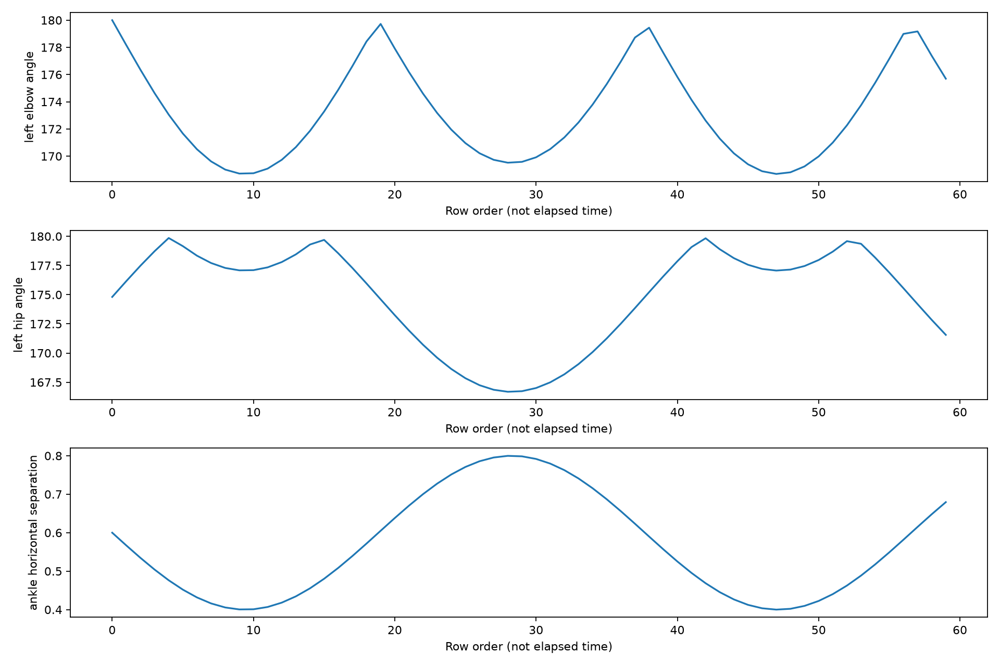

# 步行姿態於 COPD 病患分析

**亞洲大學資訊工程學系｜113 學年度畢業專題**

以臺中榮民總醫院提供的 COPD 病患步態影像為研究資料，結合 **YOLOv7 人體關鍵點擷取、步態特徵分析與多層感知機（MLP）**，探索由輕至重四類病情的分類，並透過 SHAP 分析特徵貢獻。

專題海報記載的資料規模為 **71 名病患、約 60,000 筆資料點**。本專案將資料處理、統計視覺化、模型訓練與網頁展示整合為一套 Python 工作流程。

[English](#english) · [資料格式與特徵定義](docs/data_format.md)

## 研究方法

1. **影像處理：** 將影片轉為逐幀圖片，以 YOLOv7 提取人體關鍵點並輸出 CSV。
2. **步態分析：** 整理關鍵點資料，分析頭部與軀幹、手臂與髖部角度、步距／步長及其統計量，以盒鬚圖與四分位數觀察類別差異。
3. **分類模型：** 使用 PyTorch MLP，隱藏層為 **32→64→16**，搭配 ReLU、Dropout **0.1** 與四類輸出；以 Adam、學習率 **0.001** 訓練。
4. **評估與解釋：** 分析分類指標、混淆矩陣、ROC／PR 曲線與 SHAP 特徵貢獻。

## 研究成果

| 指標 | 報告記錄 |
| --- | --- |
| 測試準確率 | **79.07%** |
| Precision | **0.76** |
| Recall | **0.79** |
| F1 | **0.77** |

上述數值來自專題報告第 35 頁；海報將準確率呈現為 **80%**。這些是當時的研究記錄，並非合成示例的執行結果。

特徵分析指出，平均頭部與軀幹角度、肩膀至髖部距離標準差與步長標準差是主要影響特徵。第一、第二類的分類表現較好，第三、第四類較難分類；擴充資料與改善類別不平衡是後續研究方向。

## 系統功能

- **CSV 分析：** 解析關鍵點、選擇追蹤對象，產生角度與距離特徵。
- **統計圖表：** 匯出逐列特徵、平均與標準差、Q1／Q2／Q3、IQR 離群標記、盒鬚圖與折線圖。
- **模型訓練：** 以受試者分組切分資料，訓練 MLP 與 Random Forest，保存模型及評估指標。
- **特徵解釋：** 使用 SHAP 分析 Random Forest 的特徵貢獻。
- **網頁介面：** 上傳 CSV 查看特徵摘要與分析結果；載入訓練權重後可顯示分類結果。

系統從已提取的關鍵點 CSV 開始操作，影片轉幀與 YOLOv7 擷取需事先完成。命令列與網頁共用特徵處理及 MLP 模型定義。

## 專案結構

```text
app.py                    Flask 網頁入口
analyze.py                特徵分析與圖表匯出
train.py                  模型訓練與評估
explain.py                SHAP 分析
models/                   MLP 定義與推論
utils/data_processor.py   共用資料處理
templates/                網頁模板
static/css/               網頁樣式
examples/make_demo.py     合成示例產生器
tests/                    自動化測試
docs/                     資料規格、驗證記錄與示例圖
requirements.txt          執行依賴
requirements-explain.txt  SHAP 額外依賴
```

## 安裝與執行

使用 Python 3.11 或 3.12，在專案根目錄執行：

```bash
python -m pip install -r requirements.txt
python examples/make_demo.py --output data/demo
python analyze.py data/demo/synthetic_pose.csv --output results/demo
python app.py
```

執行 `python app.py` 啟動網頁介面，選擇 `data/demo/synthetic_pose.csv` 即可測試分析功能。命令列分析產物存於 `results/demo`。



圖中使用合成座標示範功能，並非病患實驗圖表。

## 資料與訓練

CSV 使用 COCO 17 點的 x／y／confidence 順序，支援 `kpts` 或 `kpt_1` 至 `kpt_51`。每份記錄應只包含一位對象；多個追蹤 ID 可使用 `--track-id` 選取。完整公式、單位與缺失值處理見[資料規格](docs/data_format.md)。

訓練清單 `data/manifest.csv` 使用下列格式，相對路徑以清單所在資料夾為準：

```csv
path,subject_id,label
recording_001.csv,subject_001,class_1
recording_002.csv,subject_002,class_2
```

此表僅示範格式。每類至少需要兩位受試者，且測試比例須能涵蓋所有類別；同一人的多段記錄應共用相同 `subject_id` 與標籤。

```bash
python train.py data/manifest.csv --output artifacts/run --epochs 100 --test-size 0.25 --seed 42
python -m pip install -r requirements-explain.txt
python explain.py artifacts/run/random_forest.joblib artifacts/run/test_features.csv --output results/shap
```

程式以 11 個訊號的平均值與標準差形成 **22 個特徵**，標準化只在訓練集擬合。MLP 使用上述 32→64→16 架構；Random Forest 使用 200 棵樹、最大深度 8，作為比較與 SHAP 分析模型。

訓練會產生模型權重、`metrics.json`、資料分割清單及測試特徵。將產生的 `model.pth` 放至 `models/model.pth`，即可供網頁使用。模型須由本專案訓練或來自可信任來源；變更架構後需重新訓練權重。

預設接受所有分類。若設定 `--threshold`，指標會同時列出全體準確率、接受樣本準確率及覆蓋率。參數與門檻應透過獨立驗證資料決定。

## 驗證與使用範圍

```bash
python -m unittest discover -s tests -v
```

測試涵蓋特徵計算、資料驗證、追蹤對象選取、受試者分組、模型保存與推論，以及網頁上傳。[驗證記錄](docs/verification.md)

研究報告的結果與此處明訂的 22 特徵流程不視為完全相同的實驗。完整研究資料與對應權重未公開收錄；沒有權重時仍可使用特徵分析。資料、權重及執行產物預設排除於 Git。

---

## English

# Analysis of Walking Posture in COPD Patients

**Department of Computer Science and Information Engineering, Asia University | Academic Year 113 graduation project**

This project uses gait videos provided by **Taichung Veterans General Hospital**, combining **YOLOv7 human keypoint extraction, gait feature analysis, and an MLP** to investigate four COPD severity categories and examine feature contributions with SHAP.

The project poster describes **71 patients and approximately 60,000 data points**. The repository integrates processing, statistical visualization, training, and a web interface into one Python workflow.

### Research methods

1. **Image processing:** extract video frames, detect human keypoints with YOLOv7, and export CSV files.
2. **Gait analysis:** process keypoints and examine head–torso, arm and hip angles, step distance/length, and statistics using quartiles and boxplots.
3. **Classification:** use a PyTorch MLP with hidden layers of **32→64→16**, ReLU, dropout **0.1**, and four outputs; train with Adam at learning rate **0.001**.
4. **Evaluation and interpretation:** examine classification metrics, confusion matrices, ROC/PR curves, and SHAP contributions.

### Research results

| Metric | Reported result |
| --- | --- |
| Test accuracy | **79.07%** |
| Precision | **0.76** |
| Recall | **0.79** |
| F1 | **0.77** |

These figures come from page 35 of the project report; the poster presents accuracy as **80%**. They are study records, not results from the synthetic demonstration.

The analysis highlights mean head–torso angle, shoulder–hip distance standard deviation, and step-length standard deviation. The first and second categories performed better than the third and fourth; expanding the dataset and addressing class imbalance remain research priorities.

### System features

- **CSV analysis:** parse keypoints, select a tracked person, and calculate angle and distance features.
- **Statistics and charts:** export per-row features, mean/std, quartiles, IQR outlier flags, boxplots, and line plots.
- **Model training:** split by subject, train MLP and Random Forest, and save models and metrics.
- **Feature explanation:** analyze Random Forest feature contributions using SHAP.
- **Web interface:** upload CSVs to view feature summaries and analysis results, with classification available when trained weights are loaded.

The system starts from extracted keypoint CSVs; video frame extraction and YOLOv7 processing are prerequisites. The command-line tools and web app share feature processing and the MLP definition.

### Repository structure

| Path | Purpose |
| --- | --- |
| `app.py` | Flask web entry point |
| `analyze.py` | Feature analysis and chart export |
| `train.py` | Model training and evaluation |
| `explain.py` | SHAP analysis |
| `models/` | MLP definition and inference |
| `utils/data_processor.py` | Shared data processing |
| `templates/`, `static/css/` | Web templates and styles |
| `examples/make_demo.py` | Synthetic example generator |
| `tests/`, `docs/` | Tests, data specification, verification and example figure |
| `requirements.txt`, `requirements-explain.txt` | Runtime and optional SHAP dependencies |

### Setup and execution

Use Python 3.11 or 3.12 and run from the repository root:

```bash
python -m pip install -r requirements.txt
python examples/make_demo.py --output data/demo
python analyze.py data/demo/synthetic_pose.csv --output results/demo
python app.py
```

Run `python app.py` to launch the web interface and select `data/demo/synthetic_pose.csv` to test the analysis. Command-line analysis outputs are written to `results/demo`.


This figure demonstrates the software using synthetic coordinates, not patient study data.

### Data and training

CSV files use COCO 17 keypoints in x/y/confidence order, supplied as `kpts` or `kpt_1` through `kpt_51`. Each recording should contain one person; use `--track-id` to select among multiple tracking IDs. See the [data specification](docs/data_format.md) for formulas, units and missing-value handling.

Prepare `data/manifest.csv`; relative paths resolve from the manifest directory:

```csv
path,subject_id,label
recording_001.csv,subject_001,class_1
recording_002.csv,subject_002,class_2
```

This illustrates the format only. Each class needs at least two subjects and the test split must accommodate all classes. Recordings of one person must share the same subject ID and label.

```bash
python train.py data/manifest.csv --output artifacts/run --epochs 100 --test-size 0.25 --seed 42
python -m pip install -r requirements-explain.txt
python explain.py artifacts/run/random_forest.joblib artifacts/run/test_features.csv --output results/shap
```

The software computes **22 features** from the mean/std of 11 signals, fitting standardization on training data only. The MLP uses the 32→64→16 architecture above. Random Forest uses 200 trees and maximum depth 8 for comparison and SHAP analysis.

Training produces model weights, `metrics.json`, split assignments and test features. Place the generated `model.pth` at `models/model.pth` for web inference. Use weights trained by this project or from a trusted source; architecture changes require retraining.

All classifications are accepted by default. Setting `--threshold` reports overall accuracy, accepted-recording accuracy and coverage together. Select parameters and thresholds using independent validation data.

### Verification and scope

```bash
python -m unittest discover -s tests -v
```

Tests cover feature calculation, input validation, track selection, subject splitting, model persistence and inference, and web uploads. See the [verification record](docs/verification.md).

The reported study and this explicitly defined 22-feature workflow are not treated as identical experiments. The complete research dataset and corresponding trained weights are not included. Feature analysis works without weights. Data, weights and generated outputs are ignored by Git by default.
